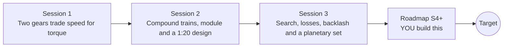

# opengears

[](https://github.com/KrunalPanchal1995/opengears/actions/workflows/ci.yml)   [](https://colab.research.google.com/github/KrunalPanchal1995/opengears/blob/main/sessions/session-01/lesson.ipynb) [](https://krunalpanchal1995.github.io/opengears/)

**Design a gearbox train to hit a target ratio and torque, in three sessions.**

opengears teaches how gear trains trade speed for torque, from one meshing pair to a searched, simulated two-stage gearbox, using only Python and a browser.

- **Start from zero.** Session 1 needs only school arithmetic: count the teeth, divide, and see which way each gear turns.
- **See it turn.** Every session ships a slider app with turning, meshing gears and labelled graphs.
- **Know you got it right.** Each session ends with a checkpoint that prints PASS or FAIL against hand calculations and exact laws.
- **Build the missing half.** The repo stops at Session 3 on purpose; the roadmap shows the path to the Target.

[Target](#the-target) · [Who is this for](#who-is-this-for) · [Quick start](#quick-start) · [Sessions](#sessions) · [Roadmap](#roadmap) · [Contribute](#contribute) · [Explainer PDF](docs/explainer.pdf)

> **This repo is incomplete on purpose.** Sessions 1 to 3 are here and fully working. The finished Target below is a preview of what the community can build next. We show you the path, not the code. Sessions 4 and up are yours.

## The Target

A gearbox designer tours every two-stage gear train whose ratio is within 1 percent of 1:20 and whose input and output shafts are in line. For each design the four gears turn with real teeth, the map shows where it sits among all feasible tooth combinations, and the readout lists speed and torque on every shaft with a loss of 2 percent per mesh. Your goal over the coming sessions: build the search, the loss model and the map yourself, then add more stages and a strength check.


*Target: a tour of in-line two-stage gearboxes near 1:20, with the feasible map and a speed-torque readout*


*Target still: the 17-76-17-76 gearbox, ratio 19.986*


*Another design from the tour: different teeth, same target ratio*

Try it live:

- [Math Visual Studio: rotational motion (Atlas S40)](https://krunalpanchal1995.github.io/studio/#atlas?ch=S40&ex=1)
- [Math Visual Studio: rigid bodies and kinematic pairs (Atlas S107)](https://krunalpanchal1995.github.io/studio/#atlas?ch=S107&ex=1)

How the Target was made is shown only as a path in [promo/roadmap.md](promo/roadmap.md).

## Who is this for
**diploma / undergraduate to advanced undergraduate (levels 5-6).** Topic area: Mechanical Engineering.

Prerequisites:

- Ratios and fractions; the idea of a force times a distance (a torque).
- Python 3.10 or newer; if `python --version` works, you are ready. PRIMER.md explains the rest.
- No prior GitHub, mechanics or numpy experience is needed.

New to Python? Read [PRIMER.md](PRIMER.md) first (10 minutes).

## Quick start

No installation knowledge needed. You need [Git](https://git-scm.com/downloads) and [Python 3.10+](https://www.python.org/downloads/) (Windows: tick "Add Python to PATH"). On Mac and Linux type `python3` wherever this page says `python`.

```bash
git clone https://github.com/KrunalPanchal1995/opengears.git
cd opengears
python start.py 1
```

`start.py` creates a private environment, installs what is needed and runs Session 1 with its checkpoint. Next: `python start.py 2`, `python start.py 3`, or `python start.py test` to check everything. Only a checkpoint: `python start.py check 1`.

Four lines turn the idea of Session 1 into a result (they work as they are): Save it as `try.py` and run it with `python start.py run try.py` (this uses the private environment, where NumPy is installed):

```python
import numpy as np
n_driver, n_driven, rpm, torque = 20, 60, 120.0, 5.0     # teeth, teeth, rpm, N m
ratio = n_driven / n_driver                              # speed ratio of the mesh
print(rpm / ratio, "rpm out,", torque * ratio, "N m out (ideal), power in", round(torque * rpm * 2 * np.pi / 60, 1), "W")
```

Every session also opens in your browser with sliders (no install): [live apps](https://krunalpanchal1995.github.io/opengears/). Or use the Colab badge above for the notebook.

## Sessions

| # | Session | Model level | Time | Live app |
|---|---|---|---|---|
| 1 | [Two gears trade speed for torque](sessions/session-01/README.md) | Level 1: conceptual interactive model | 60 min | [open](https://krunalpanchal1995.github.io/opengears/session-01/) |
| 2 | [Compound trains, module and a 1:20 design](sessions/session-02/README.md) | Level 2: mathematical engineering model | 75 min | [open](https://krunalpanchal1995.github.io/opengears/session-02/) |
| 3 | [Search, losses, backlash and a planetary set](sessions/session-03/README.md) | Level 3: simulation and validation | 90 min | [open](https://krunalpanchal1995.github.io/opengears/session-03/) |

Each session follows the same six steps: A real-world problem, B concept and theory, C visual explanation, D interactive simulation, E worked example and experiment, F assessment and design challenge. Each ends with `checkpoint.py`, which prints `PASS` or `FAIL` against reference numbers. Session 3 also contains the real-world mini-project: **Choose a gear train for a hand-crank winch**.

## Architecture



| Folder or file | What is inside |
|---|---|
| `sessions/` | three sessions: README (A-F), `lesson.py`, notebook, live app, exercises, activity sheet, checkpoint |
| `promo/` | the Target: media, live links, and the roadmap (path only) |
| `docs/` | `explainer.tex` and the built `explainer.pdf` |
| `tests/` | runs every lesson and checkpoint headless |
| `start.py` | one command to set up and run anything |
| `QUALITY.md`, `RUBRIC.md` | the quality checklist and the scoring rubric |
| `.github/` | CI, PDF build, Pages deploy, issue and PR templates |

## Roadmap

| Milestone | What you will build | Difficulty |
|---|---|---|
| Session 4: Helical gears and a smoother mesh | A contact-ratio function for helical gears and a comparison with spur gears. | intermediate |
| Session 5: Three stages in line | A grouped search for in-line three-stage trains. | intermediate |
| Session 6: Two planetary stages in series | A designer that picks Ns, Nr and the planet count for each stage. | advanced |
| Session 7: Worm drives and self-locking | A worm-pair model with efficiency and a self-locking test. | advanced |
| Session 8: Torsional resonance of the train | An eigenvalue calculation for the mesh-spring model. | advanced |

Full detail with a checkpoint per milestone: [promo/roadmap.md](promo/roadmap.md).

## Contribute
New to GitHub? Read [CONTRIBUTING.md](CONTRIBUTING.md); it starts from zero. Pick an issue labelled `good first issue`. Translations into Hindi, Telugu, Tamil and Malayalam are welcome.

<details>
<summary>Development</summary>

```bash
python start.py test        # runs every lesson and checkpoint
```
Lessons use `# %%` cell markers so they open as notebooks in VS Code. See [QUALITY.md](QUALITY.md) for the standard every session meets.
</details>

## License
MIT. See [LICENSE](LICENSE). Media in `promo/media` is (c) Krunal Panchal, CC BY 4.0.

## Acknowledgments
Part of the [PAN IIT OSS](https://hellofoss.tech-iitb.org/projects) open-source teaching collection, modelled on the structure of [openspline](https://github.com/openspline/openspline). Built on ideas from the Math Visual Studio at https://krunalpanchal1995.github.io/studio/.
