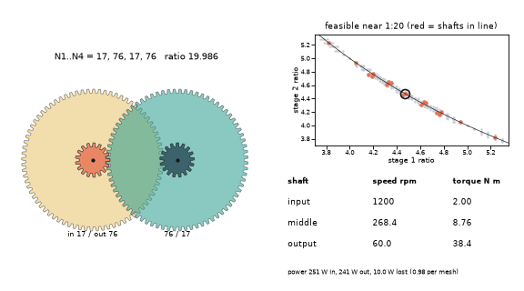
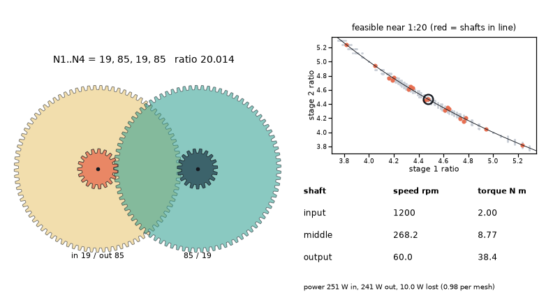

# What you are building toward

A gearbox designer tours every two-stage gear train whose ratio is within 1 percent of 1:20 and whose input and output shafts are in line. For each design the four gears turn with real teeth, the map shows where it sits among all feasible tooth combinations, and the readout lists speed and torque on every shaft with a loss of 2 percent per mesh. Your goal over the coming sessions: build the search, the loss model and the map yourself, then add more stages and a strength check.

*Target: a tour of in-line two-stage gearboxes near 1:20, with the feasible map and a speed-torque readout*

*Target still: the 17-76-17-76 gearbox, ratio 19.986*

*Another design from the tour: different teeth, same target ratio*

These results come from a private reference build. The code is not published; the roadmap shows the path so you can build your own.

Live links:

- [Math Visual Studio: rotational motion (Atlas S40)](https://krunalpanchal1995.github.io/studio/#atlas?ch=S40&ex=1)
- [Math Visual Studio: rigid bodies and kinematic pairs (Atlas S107)](https://krunalpanchal1995.github.io/studio/#atlas?ch=S107&ex=1)
