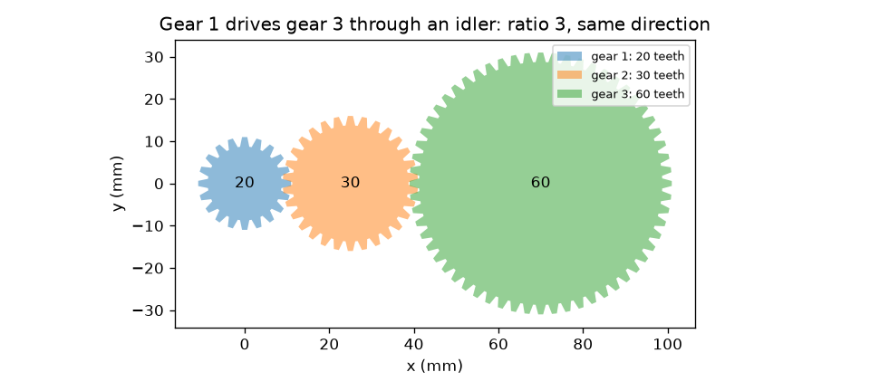
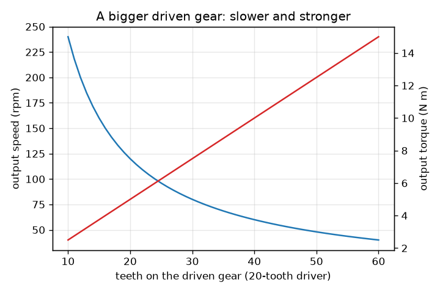

# Session 1: Two gears trade speed for torque

*Level 1 (conceptual interactive model) · about 60 minutes · opengears*

> This is a simplified educational model. It is not a validated design tool and must not be used for real structures, electrical installations, vehicles, industrial processes or medical decisions.

**Prerequisites**

- Fractions and ratios.
- You have read PRIMER.md and run `python start.py 1` once.

**Learning objectives.** After this session you can:

- Compute the output speed and torque of a meshing pair from the tooth counts.
- Explain why the bigger gear turns slower but harder, and why the two gears turn in opposite directions.
- Show that an idler flips the direction but does not change the ratio.
- Check that power (torque times speed) is the same going in and coming out of an ideal train.

## A. Real-world problem
A bicycle chain, a hand drill and the gearbox of a car all do one trick: they make a motor or a leg turn at a different speed with a different twisting force. You push a small gear and it turns a big gear slowly, but the big gear can lift much more. How is the speed given up and the strength gained, which way does each gear turn, and what does a gear in the middle (an idler) do?

## B. Concept and theory
Two gears mesh when their teeth fit together, so as one turns the teeth pass the contact point one after another: the same number of teeth pass on both gears. If the driving gear (the driver) has N_driver teeth and turns at w_in, N_driver w_in teeth pass per minute, and the driven gear must turn at w_out = w_in N_driver / N_driven. The speed ratio is i = N_driven / N_driver; i greater than 1 is a reduction. An ideal gear loses no energy, so power P = T w is the same on both sides, which means the torque goes up by the same factor: T_out = T_in i. External gears turn in opposite directions, so in a row of gears with k meshes the last gear turns the same way as the first only if k is even. A gear in the middle of the row (an idler) cancels out of the ratio but still adds a mesh, so it flips the direction.

| Symbol | Meaning | Unit |
|---|---|---|
| N_driver, N_driven | number of teeth on the driving and the driven gear | teeth |
| w | rotation speed | rpm (revolutions per minute) |
| T | torque (twisting force times arm length) | N m |
| i | speed ratio N_driven / N_driver | no unit |
| k | number of meshes in the train | no unit |
| P | power, torque times angular speed in rad/s | W |

**Assumptions**

- Ideal gears: no friction, no backlash, rigid teeth.
- External gears only (teeth on the outside rim).
- Steady turning: no acceleration.

$$ i=\frac{N_\mathrm{driven}}{N_\mathrm{driver}} $$

$$ \omega_\mathrm{out}=\frac{\omega_\mathrm{in}}{i},\qquad T_\mathrm{out}=i\,T_\mathrm{in}\quad\text{(ideal)} $$

$$ P=T\,\omega,\qquad \omega=\frac{2\pi n}{60}\quad(n\text{ in rpm},\ \omega\text{ in rad/s}) $$

$$ \text{direction after }k\text{ meshes}=(-1)^k $$

## C. Visual explanation
The first figure shows a 20-tooth gear driving a 60-tooth gear through a 30-tooth idler: the teeth really mesh, the first and last gear turn the same way, and the idler is in between. The second figure plots, for a 20-tooth driver at 120 rpm and 5 N m, the output speed (falling) and the ideal output torque (rising) as the driven gear gets more teeth: the two curves are mirror images because their product, the power, stays constant.

*A 20-tooth gear drives a 60-tooth gear through a 30-tooth idler: ratio 3, same direction.*

*Bigger driven gear: output speed falls, ideal torque rises (20-tooth driver, 120 rpm, 5 N m).*

## D. Interactive simulation
Run the lesson (`python start.py 1`), then open the live app: [Session 1: gears in a row](https://krunalpanchal1995.github.io/opengears/session-01/) (or `app.html` in this folder). Drag the turn slider to see the teeth mesh, change the tooth counts and the number of idlers, then open the two graphs and see output speed fall and torque rise as the driven gear grows.

**Challenge.** From 120 rpm, get 40 rpm out in the same direction as the input, with a 20-tooth driver.

## E. Worked example and experiment
**Problem.** A 20-tooth gear turns at 120 rpm with 5 N m and drives a 60-tooth gear. Find the output speed, torque and direction, and check the power. Then put a 30-tooth idler between them.

1. Ratio i = 60 / 20 = 3.
2. Output speed = 120 / 3 = 40 rpm, and the direction is opposite (one mesh).
3. Ideal output torque = 5 * 3 = 15 N m.
4. Power in = 5 N m * 120 rpm * 2 pi / 60 = 5 * 12.566 = 62.83 W. Power out = 15 * 4.189 = 62.83 W. They agree.
5. With the 30-tooth idler there are two meshes: the output is 40 rpm and 15 N m again, now in the same direction as the input.

**Answer.** 40 rpm and 15 N m opposite to the input (62.83 W both sides); with an idler, the same 40 rpm and 15 N m in the same direction.

**Experiment.** Take two gears from a toy or build them from a construction kit, count their teeth, and turn the small one 3 times while counting the turns of the big one. You should see about 1 turn for a 20-to-60 pair. Differences come from slipping when you count and from backlash (the small free play between teeth): the model has perfect teeth and the real gears do not.

## F. Assessment and design challenge
**Question type A: Conceptual.** If the driven gear has twice as many teeth as the driving gear, what is the ideal output speed ratio, and what real-world losses should be considered?

Hint

Teeth passing the contact point are equal on both gears. Then think about what rubs, slips or churns in a real gearbox.

Step-by-step solution

The driven gear turns at half the input speed (the speed ratio i = 2, a reduction) and, ideally, delivers twice the torque, in the opposite direction. In a real gearbox the output torque is a little less than twice because of friction between sliding teeth, bearing and seal friction, oil churning, and wasted motion across the backlash. These losses turn some input power into heat.

**Question type B: Numerical.** A 40-tooth gear drives a 20-tooth gear at 100 rpm and 4 N m. Find the output speed and ideal torque, and say what kind of train this is.

Hint

i = N_driven / N_driver = 20 / 40.

Step-by-step solution

i = 20 / 40 = 0.5, so the speed goes up: 100 / 0.5 = 200 rpm (opposite direction). Ideal torque = 4 * 0.5 = 2 N m. This is a speed-up (overdrive): the output is faster and weaker. Power check: 4 * 10.47 = 41.9 W = 2 * 20.94 = 41.9 W.

**Question type C: Graph and simulation interpretation.** In the speed and torque graphs for a 20-tooth driver at 120 rpm and 5 N m, read the output speed and torque when the driven gear has 40 teeth and when it has 60 teeth. What happens to their product?

Hint

Use speed = 120 * 20 / N and torque = 5 * N / 20.

Step-by-step solution

At 40 teeth: 60 rpm and 10 N m. At 60 teeth: 40 rpm and 15 N m. Speed falls and torque rises. The product of torque and speed (proportional to power) stays the same: 10 * 60 = 600 and 15 * 40 = 600 in these units, so the power is unchanged.

**Question type D: Design and optimisation challenge.** Design: from a 20-tooth driver at 120 rpm and 5 N m you need 40 rpm out turning the same way as the input. Choose the driven gear and the idlers, and state the output torque. What is the price of an idler?

Hint

You need ratio 3 and an even number of meshes.

Step-by-step solution

Driven gear with 60 teeth (ratio 3). Two meshes means one idler (any tooth count, for example 30; it does not change the ratio). Output: 40 rpm and 15 N m ideal, same direction. The price of an idler is one more mesh: more friction loss, more parts and more space. Session 3 puts a number on the loss.

Score yourself with [RUBRIC.md](../../RUBRIC.md). Print the [activity sheet](activity_sheet.md) to work on paper.

## Common misconceptions
| Common misconception | What is actually true |
|---|---|
| A bigger gear always turns faster. | The bigger gear turns slower: the same number of teeth pass, and a bigger gear has more of them to get through. |
| Gears give you extra power. | Gears trade speed for torque and keep the power the same (less, in reality, because of losses). |
| An idler changes the ratio. | An idler only adds a mesh, which flips the direction. Its tooth count cancels out of the ratio. |
| Two meshing gears turn the same way. | External gears turn in opposite directions; the direction after k meshes is (-1)^k. |

## Glossary
- **driver / driven**: the gear that is turned by the motor, and the gear it turns
- **idler**: a gear between two others that changes the direction but not the ratio
- **torque**: twisting force: force times the arm length, in N m
- **rpm**: revolutions per minute; multiply by 2 pi / 60 to get rad/s
- **power**: torque times angular speed, in watts
- **mesh**: the contact of two gears' teeth

## Finish
1. Do the three coding tasks in [exercises.md](exercises.md).
2. Run `python start.py 1` again after your changes. It ends with the checkpoint; when it prints `PASS`, you are done. (Checkpoint only: `python start.py check 1`.)

Next: [Session 2](../session-02/README.md)
