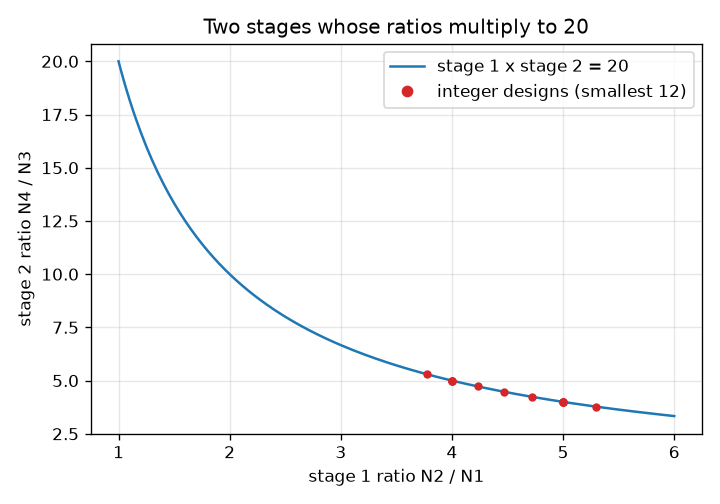
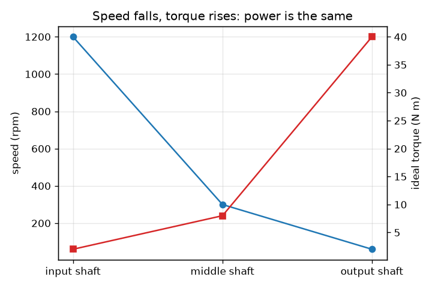

# Session 2: Compound trains, module and a 1:20 design

*Level 2 (mathematical engineering model) · about 75 minutes · opengears*

> This is a simplified educational model. It is not a validated design tool and must not be used for real structures, electrical installations, vehicles, industrial processes or medical decisions.

**Prerequisites**

- Session 1: speed ratio, torque ratio, direction.
- Fractions and whole-number search (a loop in Python).

**Learning objectives.** After this session you can:

- Compute the overall ratio, speed, ideal torque and direction of a compound train.
- Use module and tooth count to get pitch diameter and centre distance.
- Explain the minimum number of teeth (undercutting) and the contact ratio.
- Solve a design problem: a 1:20 reduction with whole numbers of teeth and the fewest total teeth.

## A. Real-world problem
A motor turns at 1200 rpm and a conveyor must turn at 60 rpm: a 1:20 reduction. One pair of gears would need a 17-tooth pinion and a 340-tooth gear, which at module 2 mm would be 680 mm across. Real gearboxes use two stages instead. Which tooth counts give exactly 1:20, with no pinion so small that its teeth are cut away, and the smallest gears?

## B. Concept and theory
In a compound train two gears sit on the same shaft and turn together; the first stage is N1 driving N2, the second is N3 (on the N2 shaft) driving N4. The stage ratios multiply: i = (N2 / N1)(N4 / N3). Output speed is w_in / i and the ideal output torque is T_in i, so power is unchanged. Every external mesh flips the direction, so two meshes turn the output the same way as the input. Gears that mesh must share the module m (tooth size in mm); a gear with N teeth has pitch diameter d = m N, and two meshing gears sit a centre distance a = (d1 + d2) / 2 = m (N1 + N2) / 2 apart. Gear cutting can remove the root of a tooth of a small pinion (undercutting); for a 20 degree pressure angle the geometric limit is 2 / sin^2(20 degrees) = 17.1 teeth, so 17 teeth is a commonly used practical guideline. The contact ratio (the average number of tooth pairs in contact) must be above 1 so that the load passes smoothly from tooth to tooth.

| Symbol | Meaning | Unit |
|---|---|---|
| N1..N4 | tooth counts of gears 1 to 4 | teeth |
| i | overall speed ratio | no unit |
| m | module (tooth size) | mm |
| d | pitch diameter m N | mm |
| a | centre distance of a mesh | mm |
| phi | pressure angle (20 degrees is standard) | degrees |
| w, T | speed and torque | rpm, N m |

**Assumptions**

- Ideal gears (no losses), so power is conserved.
- Standard full-depth spur gears with a 20 degree pressure angle, addendum equal to the module.
- All gears share one module.

$$ i=\frac{N_2}{N_1}\cdot\frac{N_4}{N_3},\qquad \omega_\mathrm{out}=\frac{\omega_\mathrm{in}}{i},\qquad T_\mathrm{out}=i\,T_\mathrm{in} $$

$$ d=mN,\qquad a=\frac{d_1+d_2}{2}=\frac{m(N_1+N_2)}{2} $$

$$ N_\mathrm{min}=\frac{2}{\sin^2\varphi}\approx 17.1\quad(\varphi=20^\circ) $$

$$ \varepsilon=\frac{\sqrt{r_{a1}^2-r_{b1}^2}+\sqrt{r_{a2}^2-r_{b2}^2}-a\sin\varphi}{\pi m\cos\varphi} $$

## C. Visual explanation
The first figure plots stage 1 ratio against stage 2 ratio. The blue hyperbola is every pair whose product is exactly 20; the red dots are the smallest integer-tooth designs, and they sit on it exactly. The second figure follows the best design along its three shafts: speed falls from 1200 to 300 to 60 rpm while the ideal torque rises from 2 to 8 to 40 N m, so the power is the same.

*All pairs of stage ratios with product 20 (blue) and the smallest integer designs (red).*

*Speed falls and ideal torque rises along the shafts of the 17-68, 17-85 design.*

## D. Interactive simulation
Run the lesson (`python start.py 2`), then open the live app: [Session 2: a two-stage compound train](https://krunalpanchal1995.github.io/opengears/session-02/) (or `app.html` in this folder). Change the four tooth counts, then watch the ratio graph and the speed and torque along the shafts. Look at the picture: gears 1 and 4 should share the input axis.

**Challenge.** Get an overall ratio of 20 (within 0.1) with both pinions at 17 teeth or more and the output shaft in line with the input shaft.

## E. Worked example and experiment
**Problem.** Reduce 1200 rpm to 60 rpm (ratio 20) with two stages, whole numbers of teeth from 17 to 100, and the fewest total teeth. Give the speeds and ideal torques for a 2 N m input, and check the centre distances at module 2 mm.

1. We need (N2 / N1)(N4 / N3) = 20. List every pair (N_driver, N_driven) with 17 to 100 teeth, group them by exact ratio, and join two groups whose ratios multiply to 20: there are 146 such designs (counting both orders).
2. The smallest total is 17 + 68 + 17 + 85 = 187 teeth: stage ratios 68 / 17 = 4 and 85 / 17 = 5, and 4 * 5 = 20 exactly.
3. Speeds: 1200 / 4 = 300 rpm on the middle shaft (reversed), then 300 / 5 = 60 rpm on the output (same way as the input).
4. Ideal torques: 2 N m, then 2 * 4 = 8 N m, then 8 * 5 = 40 N m. The power is the same on every shaft.
5. Centre distances at module 2 mm: 2 * (17 + 68) / 2 = 85 mm and 2 * (17 + 85) / 2 = 102 mm. They are not equal, so the output shaft is not in line with the input shaft (only 4 of the 146 designs are in line; Session 3 searches for them).

**Answer.** 17-68 then 17-85 (187 teeth): 1200 to 300 to 60 rpm, 2 to 8 to 40 N m ideal, same direction as the input, but the centre distances are 85 mm and 102 mm.

**Experiment.** Build a two-stage train from a construction kit, mark the input and output shafts, and count how many input turns make one output turn: you should count 20 for the exact design above. Hang a weight on the output arm and measure the input torque with a spring scale: it will be a little more than 1/20 of the load torque because of friction, which the ideal model leaves out.

## F. Assessment and design challenge
**Question type A: Conceptual.** Why is a two-stage train better than one pair of gears for a 1:20 reduction? Give two reasons.

Hint

Compare the biggest gear in each design, at module 2 mm.

Step-by-step solution

One stage with the 17-tooth pinion needs a 340-tooth gear, a pitch diameter of 2 * 340 = 680 mm. The two-stage design's biggest gear has 85 teeth, 2 * 85 = 170 mm across: smaller, lighter and cheaper to make, and it fits in a smaller housing. Also each pair keeps a moderate ratio (4 and 5), which keeps tooth sizes and loads reasonable.

**Question type B: Numerical.** A train has stages 20-50 and 18-72. Find the overall ratio, the output speed and the ideal output torque for 900 rpm and 3 N m in, and the direction.

Hint

Multiply the stage ratios.

Step-by-step solution

i = (50 / 20)(72 / 18) = 2.5 * 4 = 10. Output speed = 900 / 10 = 90 rpm. Ideal output torque = 3 * 10 = 30 N m. Two meshes, so the output turns the same way as the input. Power check: the torque rose 10 times and the speed fell 10 times.

**Question type C: Graph and simulation interpretation.** In the ratio graph with N1 = 20, N2 = 60 and N3 = 20, which N4 gives a ratio of 20? Can you set that on the slider?

Hint

The ratio is N2 N4 / (N1 N3), a straight line in N4.

Step-by-step solution

The line is ratio = 60 * N4 / 400 = 0.15 N4. Setting it to 20 gives N4 = 133.3, which is outside the slider range (30 to 100) and not a whole number. The line is below 20 everywhere on the graph; you have to change N1, N2 or N3 too.

**Question type D: Design and optimisation challenge.** Design: find the exact two-stage reduction of 1:12 with 17 to 100 teeth and the fewest total teeth. Give the centre distances at module 2 mm.

Hint

Try stage ratios such as 3 and 4, and the pinion 17.

Step-by-step solution

17-51 (ratio 3) then 17-68 (ratio 4): 3 * 4 = 12, total 17 + 51 + 17 + 68 = 153 teeth. Centre distances at module 2 mm: 2 * (17 + 51) / 2 = 68 mm and 2 * (17 + 68) / 2 = 85 mm: not equal, so the shafts are not in line. Trade-off: the smallest design is not always the one that fits the housing.

Score yourself with [RUBRIC.md](../../RUBRIC.md). Print the [activity sheet](activity_sheet.md) to work on paper.

## Common misconceptions
| Common misconception | What is actually true |
|---|---|
| The overall ratio is the sum of the stage ratios. | It is the product: two stages of 4 and 5 give 20, not 9. |
| Any number of teeth works. | Tooth counts must be whole numbers, and a pinion below about 17 teeth is cut away (undercut) for a 20 degree pressure angle. |
| Gears that mesh can have different modules. | They must share the module; otherwise the teeth do not fit. |
| The smallest design always fits. | The two stages must also have centre distances that suit the housing, and for an in-line gearbox they must be equal. |

## Glossary
- **compound train**: a train where two gears share a shaft, so stage ratios multiply
- **module**: tooth size in mm: pitch diameter divided by the number of teeth
- **pitch diameter**: the diameter of the imaginary circle on which two gears roll on each other
- **centre distance**: distance between the axes of two meshing gears
- **undercutting**: removal of the tooth root of a small pinion by the cutter
- **contact ratio**: the average number of tooth pairs in contact; it must exceed 1

## Finish
1. Do the three coding tasks in [exercises.md](exercises.md).
2. Run `python start.py 2` again after your changes. It ends with the checkpoint; when it prints `PASS`, you are done. (Checkpoint only: `python start.py check 2`.)

Next: [Session 3](../session-03/README.md)
