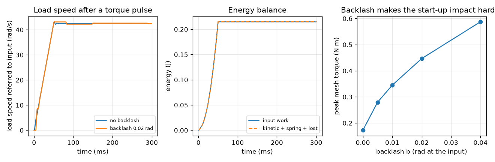
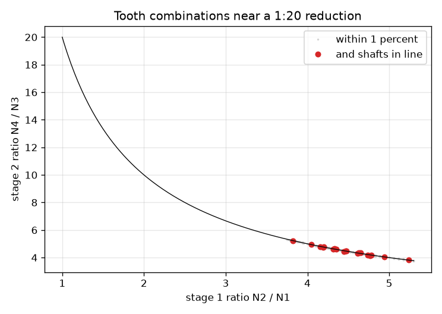

# Session 3: Search, losses, backlash and a planetary set

*Level 3 (simulation and validation) · about 90 minutes · opengears*

> This is a simplified educational model. It is not a validated design tool and must not be used for real structures, electrical installations, vehicles, industrial processes or medical decisions.

**Prerequisites**

- Session 2: compound ratio, module, centre distance.
- Arrays in numpy (a loop and a boolean mask).

**Learning objectives.** After this session you can:

- Search every tooth combination with numpy for a target ratio, a tolerance and an in-line constraint.
- Model mesh losses and simulate a two-stage train with backlash, checked against momentum and energy balance.
- Verify the planetary (Willis) relation and the ratio 1 + Nr / Ns with code.
- Detect failing designs: non-integer teeth, undercut pinions, unequal centre distances, a box that is too small.

## A. Real-world problem
The smallest 1:20 design of Session 2 had centre distances of 85 mm and 102 mm, so a gearbox with the input and output shafts in line cannot be built from it. A real design must also hit the ratio to a tolerance, survive a torque pulse when the motor starts, and waste little power. Which tooth counts work, what do 2 percent per mesh and a loose fit between the teeth cost, and how does a planetary gear set pack a large ratio into a small space?

## B. Concept and theory
Search: for two stages with the same module the shafts are in line when N1 + N2 = N3 + N4. Numpy tests every (N2, N3, N4) for each N1 at once. Losses: each mesh transmits about 98 percent of the power (a typical figure; real values depend on gears, lubricant and load), so n meshes keep 0.98^n, and power in = power out + loss. Dynamics: refer every shaft to the input by dividing its angle by its ideal ratio rho; its inertia then counts as J rho^2, and a mesh is a spring k with a dead zone b (backlash) and damping c while the teeth touch. When all teeth touch, the train acts as one inertia J_eff = sum of J rho^2 (for one stage J1 + J2 (N1 / N2)^2). Two exact checks: the total momentum sum J rho^2 w grows by exactly the torque impulse (internal mesh forces cancel), and input work = kinetic energy + spring energy + energy lost in damping. Planetary set: a sun (Ns teeth), a ring (Nr teeth, internal) and planets on a carrier (Np = (Nr - Ns) / 2 teeth). The Willis relation w_sun Ns + w_ring Nr = w_carrier (Ns + Nr) links the three speeds; with the ring fixed and the sun as input the ratio is 1 + Nr / Ns. The planets must also space evenly: (Ns + Nr) must be divisible by the number of planets.

| Symbol | Meaning | Unit |
|---|---|---|
| N1..N4 | tooth counts | teeth |
| tol | allowed relative ratio error | no unit |
| eta | efficiency per mesh (typical 0.98) | no unit |
| rho | ideal speed of a shaft divided by the input speed | no unit |
| J | shaft inertia | kg m^2 |
| k, c, b | mesh stiffness, damping and backlash, referred to the input | N m/rad, N m s/rad, rad |
| w_sun, w_ring, w_carrier | speeds of the planetary set | rpm |
| Ns, Nr | sun and ring teeth | teeth |

**Assumptions**

- Simplified educational model, not a validated gearbox design tool.
- Lumped rigid inertias; each mesh is one spring with a dead zone and damping while in contact; stiffness and damping values are illustrative.
- The 98 percent per mesh is a typical figure; real efficiency depends on load, speed and lubrication.
- Spur gears, one module for both stages.

$$ \varepsilon=\left|\frac{N_2N_4}{N_1N_3\,i_\mathrm{target}}-1\right|\le \mathrm{tol},\qquad N_1+N_2=N_3+N_4\ \text{(in line)} $$

$$ \eta_\mathrm{total}=\eta^{\,n},\qquad P_\mathrm{in}=P_\mathrm{out}+P_\mathrm{loss} $$

$$ J_\mathrm{eff}=\sum_i J_i\rho_i^{2}=J_1+J_2\Big(\frac{N_1}{N_2}\Big)^{2}+\dots $$

$$ \sum_i J_i\rho_i^{2}\,\dot\varphi_i=\int T\,dt,\qquad \int T\dot\varphi_1\,dt=E_\mathrm{kin}+E_\mathrm{spring}+E_\mathrm{lost} $$

$$ \omega_s N_s+\omega_r N_r=\omega_c\,(N_s+N_r),\qquad \frac{\omega_s}{\omega_c}=1+\frac{N_r}{N_s}\ \ (\omega_r=0) $$

## C. Visual explanation
The first figure is a map of tooth combinations near a 1:20 reduction: stage 1 ratio against stage 2 ratio. Grey dots are the 467 designs within 1 percent (17 to 90 teeth); the 19 red dots also have the shafts in line, and all lie close to the product-20 curve. The second figure has three panels: input and load speed after a torque pulse (the load starts late when there is backlash), the energy balance (input work equals kinetic plus spring plus lost energy), and the peak mesh torque, which grows with backlash.

*Torque pulse on a two-stage train: speeds, energy balance and the peak mesh torque against backlash.*

*Feasible tooth combinations near 1:20: 467 within 1 percent, 19 with the shafts in line.*

## D. Interactive simulation
Run the lesson (`python start.py 3`), then open the live app: [Session 3: a torque pulse on a two-stage train](https://krunalpanchal1995.github.io/opengears/session-03/) (or `app.html` in this folder). Open the train view to see the backlash gap, then use the speed, energy and mesh-torque views while you change the torque pulse, backlash, damping and load inertia. Watch the two error numbers in the readout stay tiny.

**Challenge.** Reach at least 60 rad/s at the input after the pulse with a backlash of at most 0.01 rad.

## E. Worked example and experiment
**Problem.** Search 17 to 90 teeth for an in-line two-stage 1:20 within 1 percent and take the design with the fewest teeth. Then, for input and load inertias J1 = 1e-4, middle shaft 2e-4 and load 0.05 kg m^2, find J_eff, the input speed after a 0.2 N m pulse of 0.05 s, and the output speed.

1. No exact in-line 1:20 exists in this range, but 19 designs lie within 1 percent; the fewest teeth are in 17-76 then 17-76 with ratio (76 / 17)^2 = 19.986.
2. Both stages have N + N = 93, so the centre distances are equal and the shafts are in line.
3. rho for the shafts: 1, 17 / 76 = 0.2237, and 0.2237^2 = 0.0500.
4. J_eff = 1e-4 + 2e-4 * 0.0500 + 0.05 * 0.0500^2 = 1.0e-4 + 1.0e-5 + 1.25e-4 = 2.352e-4 kg m^2.
5. Impulse = 0.2 * 0.05 = 0.01 N m s, so the input turns at 0.01 / 2.352e-4 = 42.5 rad/s once the teeth are all in contact (the simulation gives 42.5).
6. Output speed = 42.5 * 0.0500 = 2.13 rad/s = 20.3 rpm. At 98 percent per mesh, 2 meshes would keep 0.9604 of the power.

**Answer.** 17-76-17-76 (ratio 19.986, 93 + 93 in line); J_eff = 2.352e-4 kg m^2; the input reaches 42.5 rad/s and the output 20.3 rpm. The simulation agrees: momentum equals the impulse and input work equals kinetic + spring + lost energy.

**Experiment.** Measure backlash on a real gearbox: lock the input shaft and rock the output by hand; read the free angle at the output and multiply by the ratio to refer it to the input. Compare the efficiency by measuring input power (torque times speed) and output power with a brake: it is usually a few percent lower per stage than the typical 98 percent. The model differs because real teeth bend, real contact is not a simple dead zone, and friction depends on load and speed.

## Real-world application and mini-project: Choose a gear train for a hand-crank winch
A hand-crank winch must hold and lift a 50 kg load on a rope drum of radius 0.12 m, using a crank of radius 0.15 m, 40 rpm at the crank and a rope speed of at least 0.10 m/s. The hand force must stay at or below 85 N (a 15 percent margin under the 100 N limit), each mesh gets 98 percent (typical), the gears are module 2 mm, and every mesh must stay within an 80 mm centre distance. Use `crank_force`, `rope_speed` and `winch_candidates` from Session 3 (illustrative numbers, not a real design). Show that no single stage works, then pick a two-stage train with an engineering argument.

**Deliverable:** A script that prints the best single-stage force, the number of two-stage designs that meet the limits, the fewest-teeth design with its ratio, hand force and rope speed, and a one-paragraph argument for your pick that mentions the brake needed to hold the load (spur gear trains do not self-lock).

**Success looks like:** The best single stage needs 108.0 N, which is too much; the fewest-teeth two-stage train has 109 teeth (17-34 then 17-41, ratio 4.824), needs 84.7 N and lifts at 0.104 m/s.

## F. Assessment and design challenge
**Question type A: Conceptual.** Why does backlash make the start-up impact harder, and why is the final speed hardly affected?

Hint

Think about what the motor side does while the teeth are not touching, and what is conserved.

Step-by-step solution

While the gap closes the motor side accelerates alone with only part of the inertia, so it hits the load side at a higher relative speed and the mesh torque spikes. The momentum is conserved (internal mesh forces cancel), so once the oscillation dies the speeds settle to nearly the same values: backlash changes the shock and the delay, not the final speed.

**Question type B: Numerical.** A planetary set has Ns = 24 and Nr = 72. With the ring fixed and the sun at 900 rpm, find the planet teeth, the ratio and the carrier speed. Then a four-mesh spur train takes 500 W: how much power is lost at 98 percent per mesh?

Hint

Np = (Nr - Ns) / 2 and ratio = 1 + Nr / Ns; 0.98^4.

Step-by-step solution

Np = (72 - 24) / 2 = 24 teeth. Ratio = 1 + 72 / 24 = 4, so the carrier turns at 900 / 4 = 225 rpm (Willis: 900 * 24 = w_c * 96). For the spur train: 0.98^4 = 0.9224, so 500 * 0.9224 = 461.2 W comes out and 38.8 W is lost.

**Question type C: Graph and simulation interpretation.** In the mesh-torque view, the peak mesh torque is 0.172 N m for no backlash and 0.447 N m for 0.02 rad. At 0.04 rad it is 0.588 N m. What is the trend and what does it mean for gear wear?

Hint

Compare the three values and ask what a bigger gap does to the impact.

Step-by-step solution

The peak rises with backlash: 0.172, 0.447 and 0.588 N m (and 0.345 at 0.01 rad). Even though the gap is small, a loose train takes up the gap with an impact, so tooth contact stresses and noise grow. This is why precision drives use low backlash or anti-backlash gears, at the price of more friction and cost.

**Question type D: Design and optimisation challenge.** Design: find the in-line two-stage gearbox for 1:16 within 1 percent with 17 to 90 teeth and the fewest total teeth. Is the ratio exact? Check it with the checker at module 2 mm.

Hint

Use search_trains(16, 0.01) and take the row with the smallest sum.

Step-by-step solution

There are 46 in-line designs; the smallest is 17-68-17-68, ratio exactly 16, both stages with N + N = 85 (centre distance 85 mm at module 2). check_design returns no problems. Trade-off: equal stages are easy to build and in line, but two 68-tooth gears are not the smallest possible if you drop the in-line condition.

Score yourself with [RUBRIC.md](../../RUBRIC.md). Print the [activity sheet](activity_sheet.md) to work on paper.

## Common misconceptions
| Common misconception | What is actually true |
|---|---|
| If the ratio is off by a tiny amount the design is wrong. | Real designs have a tolerance; whole-tooth counts rarely hit a ratio exactly. Here 19.986 is within 1 percent of 20. |
| Efficiency is 98 percent for the whole gearbox. | It is about 98 percent per mesh (typical), so a long train keeps 0.98^n: six meshes keep 0.8858. |
| Backlash slows the final speed. | It delays the start and makes the impact harder; the final speed is set by the conserved momentum. |
| Planetary gears only reduce speed. | The Willis relation holds for any combination of fixed and moving parts: fixing the carrier reverses the ring instead. |

## Glossary
- **in line (coaxial)**: input and output shafts share one axis; needs equal centre distances
- **backlash**: free play between meshing teeth
- **reflected inertia**: an inertia expressed at the input shaft: J times the ratio squared
- **Willis relation**: the speed equation of a planetary gear set
- **sun, ring, carrier**: the central gear, the outer internal gear, and the arm that holds the planets
- **tolerance**: the allowed relative error of the ratio

## Finish
1. Do the three coding tasks in [exercises.md](exercises.md).
2. Run `python start.py 3` again after your changes. It ends with the checkpoint; when it prints `PASS`, you are done. (Checkpoint only: `python start.py check 3`.)

Next: the [roadmap](../../promo/roadmap.md). Session 4 is yours to build.
